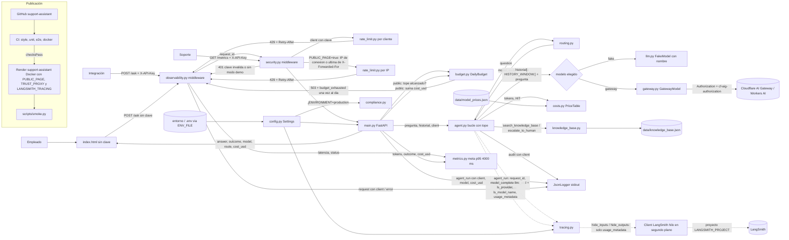

# Arquitectura del Support Assistant

El Support Assistant es el primer nivel de la mesa de ayuda. La persona describe su problema
en una página web; un agente lo clasifica, busca una solución vigente en la base de
conocimiento y, si no la encuentra, indica a qué equipo humano se transfiere. Cada petición
lleva un folio (`request_id`) que permite reconstruir en el log qué pasó con ella, y cada
respuesta dice qué modelo usó y cuánto costó. Las integraciones entran con una clave de
cliente y un límite por minuto. Con el modo demo (`PUBLIC_PAGE=true`) la página se usa sin
clave, como el cliente `public`, con un límite por IP y un tope de gasto diario. Con
LangSmith encendido, cada corrida queda como traza con sus tokens, su costo y etiquetas
para filtrar, sin mandar el texto de la conversación en producción. El servicio se publica
en Render (`support-assistant`) solo si el pipeline de CI pasa.

## Componentes

| Archivo | Responsabilidad |
| --- | --- |
| `app/main.py` | `create_app()`, `create_models()` y `app`: rutas `GET /`, `GET /health`, `POST /ask`, `GET /metrics`; `502` si el modelo falla, `503` si se agotó el tope de la demo; pasa el cliente al agente |
| `app/config.py` | Lee `ENV_FILE` (sin pisar el entorno), valida las variables (`Settings`, incluidos el modo demo, `LANGSMITH_PROJECT` y `SLO_P95_MS=4000`) y aplica compliance |
| `app/security.py` | Interpreta `API_KEYS`, identifica al cliente con `compare_digest`, resuelve la IP (`resolve_client_ip`) y middleware de `401`/`429` para clientes con clave y para `public` |
| `app/rate_limit.py` | Ventana deslizante de 60 s por llave (cliente o IP) con el reloj inyectado, `Retry-After` y purga de llaves inactivas |
| `app/budget.py` | Tope de gasto diario de `public`: suma por día UTC, aviso una vez por día y valores para `/metrics` |
| `app/compliance.py` | Reglas de `ENVIRONMENT=production` que impiden arrancar |
| `app/agent.py` | Bucle con tope, ventana de historial, búsqueda con las palabras de la persona, costo por llamada; trazas `llm` por llamada y metadatos y etiquetas al final de `agent_run` |
| `app/llm.py` | Interfaz `complete(messages)`, `Completion` y modelos simulados con nombre (`provider = "fake"`) |
| `app/gateway.py` | Modelo real (Workers AI vía AI Gateway autenticado, `provider = "cloudflare"`) con prompt de sistema, caché y sin reintentos |
| `app/routing.py` | Regla que elige `MODEL_SMALL` o `MODEL_LARGE` y su motivo (`route`) |
| `app/costs.py` | Tabla de precios y costo en USD por llamada |
| `app/knowledge_base.py` | Carga de la base, búsqueda determinista y transferencia |
| `app/observability.py` | Reloj, folio, log JSON (con `client`, nunca la IP) y middleware de petición y error |
| `app/metrics.py` | Métricas del proceso (latencia, errores, tokens, outcomes, costo, meta p95) |
| `app/tracing.py` | Trazas opcionales en LangSmith: proyecto propio, `hide_*` como funciones (solo sale `usage_metadata`), `usage_metadata` por llamada y anotación de la corrida que nunca lanza |
| `app/static/index.html` | Página web sin clave: historial en el navegador, folio visible y mensajes de 401, 429 y 503 |
| `data/knowledge_base.json` | Categorías, equipos y artículos (copia de `spec/`) |
| `data/model_prices.json` | Precios por modelo en USD por millón de tokens (copia de `spec/`) |
| `.env.example` | Todas las variables de `spec/` (salvo `ENV_FILE`) con su valor por omisión y los secretos vacíos |
| `Dockerfile`, `.dockerignore` | Imagen `python:3.12-slim` con usuario no root, `app/` y `data/`, sin `.env` |
| `.github/workflows/ci.yml` | Pipeline `style` -> `unit` -> `e2e` (con `PUBLIC_PAGE=true`) -> `docker` |
| `render.yaml` | Blueprint del servicio `support-assistant` con `autoDeployTrigger: checksPass`, el modo demo y las trazas (`LANGSMITH_TRACING`, `LANGSMITH_PROJECT`, `SLO_P95_MS`) |
| `scripts/smoke.py` | Prueba de humo: `/health`, `401` con clave equivocada y `200` con `SMOKE_API_KEY` |
| `doc/compliance-checklist.md` | Reglas de compliance, dónde están, cómo se comprueban y decisiones aceptadas |

## Diagrama

## Flujo

1. Al arrancar se lee `ENV_FILE` (el entorno gana), se valida la configuración, se
   interpreta `API_KEYS` y, con `ENVIRONMENT=production`, se aplican las reglas de
   compliance. Con `PUBLIC_PAGE=true` el tope y el límite por IP deben ser mayores que 0
   y `public` no puede ser un cliente de `API_KEYS`. Si algo falla, el proceso no arranca.
2. Con `LANGSMITH_TRACING=true` y clave, `tracing.configure()` crea el cliente de
   LangSmith con las funciones de ocultar y el proyecto `LANGSMITH_PROJECT`; sin clave no
   se importa `langsmith`.
3. La página manda la pregunta y el historial sin clave; una integración manda además
   `X-API-Key`. El middleware de observabilidad asigna el folio.
4. El middleware de seguridad: con `X-API-Key`, identifica al cliente (`401` si no es
   válida) y revisa su límite por minuto. Sin clave, `401` salvo en modo demo; en modo
   demo revisa el límite por IP (`429` con `Retry-After`) y marca la petición como
   `public`. La IP nunca sale del middleware.
5. La API valida la pregunta. Si es de `public` y lo gastado hoy (UTC) llega al tope:
   `budget_exhausted` la primera vez del día y `503` sin llamar al modelo.
6. Si no, llama al agente con el folio y el cliente en la traza. El enrutador elige el
   modelo; el agente manda solo los últimos `HISTORY_WINDOW` mensajes más la pregunta.
   Cada llamada al modelo es una traza `llm` con sus tokens en `usage_metadata`.
7. En cada vuelta se suma el costo de la llamada (0 si el gateway respondió `HIT`). La
   transferencia termina el bucle con `Te comunico con <team>.`. Al terminar, `agent_run`
   recibe sus metadatos (`outcome`, `cost_usd`, `client`...) y las etiquetas
   `outcome:`, `route:` y `model:`.
8. Se escriben `audit`, `agent_run` y `request` con `client`; se suman tokens, `outcome`
   y costo a las métricas y, si es `public`, el costo al gasto del día. Las trazas se
   envían en segundo plano: si LangSmith falla, la respuesta no cambia.
9. Si el modelo real falla: evento `error` con el tipo y `502 {"detail": "model
   unavailable", "request_id"}`, sin reintentos.
10. La página pinta la respuesta con `textContent`, el `request_id`, el aviso
    `escalation` si hubo transferencia, o el mensaje de 401, 429 o 503.

## Decisiones

- [0001 API sin estado](adr/0001-stateless-api.md)
- [0002 Interfaz del modelo](adr/0002-model-interface.md)
- [0003 Bucle con tope](adr/0003-bounded-agent-loop.md)
- [0004 Folio por petición y log JSON](adr/0004-request-id-and-json-log.md)
- [0005 Métricas en memoria del proceso](adr/0005-process-local-metrics.md)
- [0006 Trazas opcionales en LangSmith](adr/0006-optional-langsmith-tracing.md)
- [0007 Modelo real como adaptador, sin reintentos](adr/0007-gateway-model-adapter.md)
- [0008 Enrutamiento por regla y costo por llamada](adr/0008-rule-based-routing-and-cost-accounting.md)
- [0009 Configuración desde `.env`](adr/0009-config-from-env-file.md)
- [0010 Una clave por cliente, revisada en un middleware](adr/0010-api-keys-per-client.md)
- [0011 Límite de peticiones por cliente en memoria](adr/0011-process-local-rate-limit.md)
- [0012 Compliance al arrancar y publicación con el pipeline en verde](adr/0012-compliance-as-code-and-gated-deploy.md)
- [0013 Modo demo: el cliente `public` sin clave](adr/0013-public-demo-client.md)
- [0014 Límite por IP con el proxy de confianza](adr/0014-per-ip-limit-behind-trusted-proxy.md)
- [0015 Tope de gasto diario en memoria del proceso](adr/0015-process-local-daily-budget.md)
- [0016 Llamadas al modelo como trazas `llm` con tokens y texto oculto](adr/0016-llm-runs-with-usage-and-hidden-text.md)
- [0017 Metadatos y etiquetas de `agent_run`](adr/0017-run-outcome-metadata-and-tags.md)
- [0018 Trazas en segundo plano, proyecto propio y meta p95 de 4 s](adr/0018-background-tracing-own-project-and-4s-slo.md)
